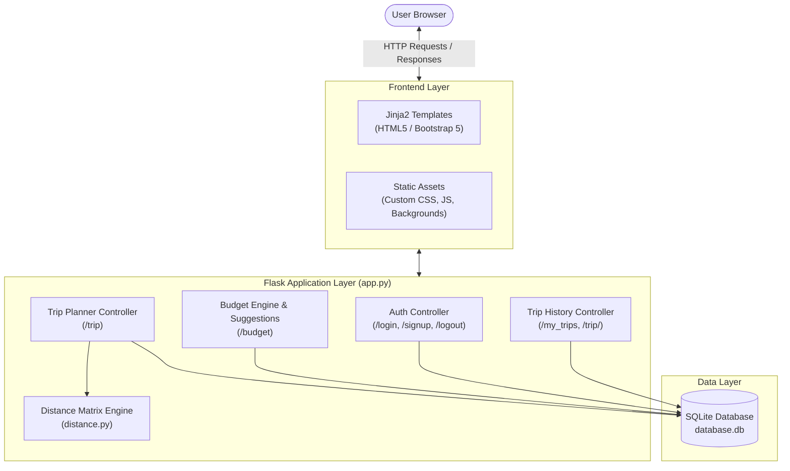
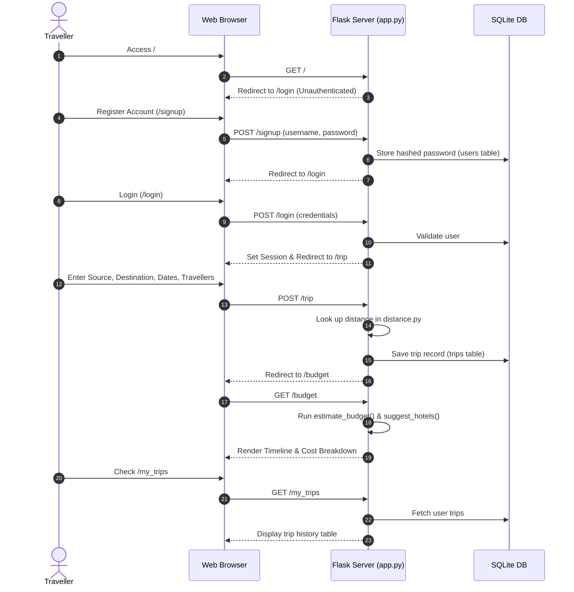
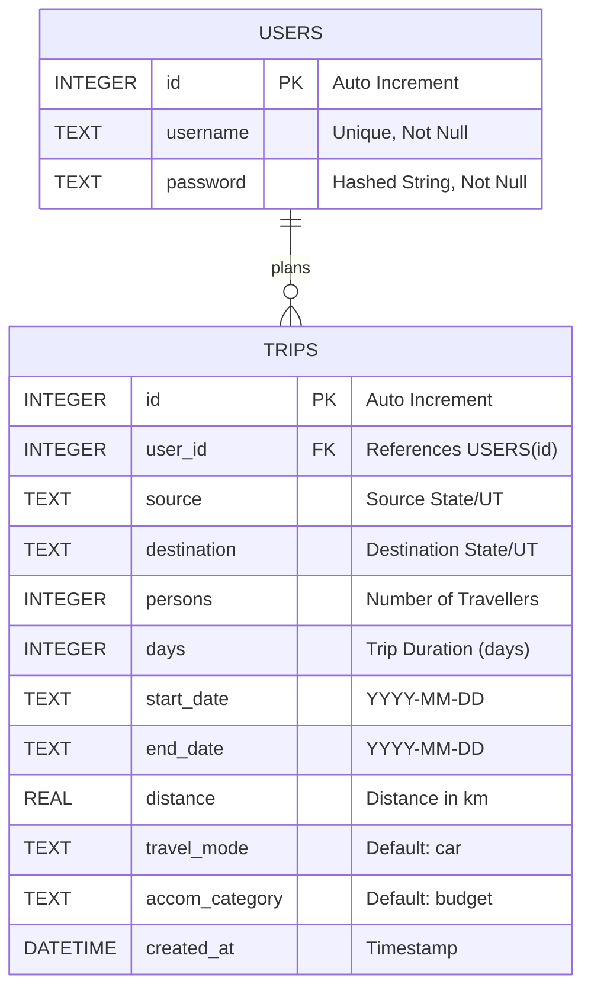

# 🌍 Travel Planner Web Application

[](https://www.python.org/)
[](https://flask.palletsprojects.com/)
[](https://www.sqlite.org/)
[](https://getbootstrap.com/)
[](LICENSE)

A full-featured, responsive web application built with **Flask**, **SQLite**, and **Bootstrap 5** designed to simplify domestic travel planning across India. The application assists users in planning routes between Indian states and Union Territories, estimating realistic budgets (intercity travel, local transport, accommodation, and food), exploring transport modes, and saving custom itineraries.

Repository: **[mahaboobali1212/Travel-Planner-WEB-Application](https://github.com/mahaboobali1212/Travel-Planner-WEB-Application.git)**

---

## 📑 Table of Contents
1. [Key Features](#-key-features)
2. [Workflow & Architecture](#-workflow--architecture)
   - [System Architecture](#system-architecture)
   - [User Journey Flow](#user-journey-flow)
3. [Tech Stack](#-tech-stack)
4. [Project Structure](#-project-structure)
5. [Database Schema](#-database-schema)
6. [Budget Estimation Logic](#-budget-estimation-logic)
7. [Installation & Setup](#-installation--setup)
8. [Available Endpoints & Routes](#-available-endpoints--routes)
9. [Future Roadmap](#-future-roadmap)
10. [Author & Acknowledgments](#-author--acknowledgments)

---

## ✨ Key Features

- 🔐 **User Authentication**: Secure sign-up and login with password hashing via Werkzeug (`generate_password_hash` / `check_password_hash`) and session protection.
- 🗺️ **State-to-State Distance Engine**: Pre-computed distance matrix for all 28 Indian States and 8 Union Territories in `distance.py`.
- 💰 **Intelligent Budget Estimator**: Dynamic calculation of total trip expense broken down by:
  - Intercity travel based on distance & group size
  - Daily local transit costs
  - Hotel stay calculations factoring in group size and room allocation
  - Per-person daily food expenses
- 🏨 **Curated Recommendations**: Automatic hotel and stay suggestions tailored to the selected destination, alongside multi-modal transit options (Flight, Train, Bus, Cab/Taxi, Metro).
- 📜 **Interactive Timeline View**: Visual timeline breakdown showing itinerary summaries, transit logistics, lodging, and grand totals.
- 🗂️ **Trip History & Management**: View previously planned trips, review budget details, and clear trip history at any time.

---

## 🔄 Workflow & Architecture

### System Architecture



---

### User Journey Flow



---

## 🛠️ Tech Stack

| Component | Technology | Description |
| :--- | :--- | :--- |
| **Backend** | Python 3.8+ / Flask 3.0 | Lightweight WSGI web application framework |
| **Authentication** | Werkzeug Security | Industry-standard password hashing and validation |
| **Database** | SQLite3 | Embedded SQL relational database engine |
| **Templating** | Jinja2 | Dynamic HTML rendering with shared layouts |
| **Frontend** | HTML5, CSS3, JavaScript | Responsive user interface with custom timeline styles |
| **Styling** | Bootstrap 5 | Mobile-friendly grid system, forms, and components |

---

## 📁 Project Structure

```text
Travel-Planner-WEB-Application/
│
├── app.py                     # Main Flask application and route controllers
├── models.py                  # Database connection, schemas, and table initialization
├── distance.py                # Pairwise road distance matrix for Indian states/UTs
├── database.db                # SQLite database file storing users & itineraries
├── requirements.txt           # Python dependency requirements
├── README.md                  # Comprehensive project documentation
│
├── templates/                 # Jinja2 HTML Templates
│   ├── base.html              # Base layout with navbar, alerts, and container blocks
│   ├── login.html             # User login portal
│   ├── signup.html            # New user registration portal
│   ├── trip.html              # Trip planning form with Indian state datalist
│   ├── budget.html            # Timeline view of budget breakdown and hotel recommendations
│   ├── my_trips.html          # History table of planned trips
│   └── previous_trips.html    # Previous trip archive view
│
└── static/                    # Static Assets
    ├── css/
    │   └── styles.css         # Custom styling for cards, buttons, and responsive timeline
    ├── js/
    │   └── main.js            # Client-side scripts and date calculation helpers
    └── images/                # Background visuals for individual views
        ├── login-bg.jpg
        ├── signup-bg.jpg
        ├── trip-bg.jpg
        ├── budget-bg.jpg
        └── my_trips.jpg
```

---

## 🗄️ Database Schema



---

## 🧮 Budget Estimation Logic

Budgets are calculated deterministically via `estimate_budget(persons, days, distance)` in `app.py`:

$$\text{Transport Cost} = \text{distance (km)} \times ₹5 \times \text{persons}$$

$$\text{Local Transit} = ₹200 \times \text{days} \times \text{persons}$$

$$\text{Rooms Required} = \max\left(1, \left\lceil \frac{\text{persons}}{2} \right\rceil\right)$$

$$\text{Accommodation Cost} = ₹1,800 \times \text{rooms} \times \text{days}$$

$$\text{Food & Dining} = ₹500 \times \text{days} \times \text{persons}$$

$$\mathbf{Total\ Estimated\ Budget} = \text{Transport} + \text{Local Transit} + \text{Accommodation} + \text{Food}$$

---

## 🚀 Installation & Setup

### Prerequisites
- Python 3.8 or higher installed on your system
- Git installed on your system

### 1. Clone the Repository
```bash
git clone https://github.com/mahaboobali1212/Travel-Planner-WEB-Application.git
cd Travel-Planner-WEB-Application
```

### 2. Create and Activate a Virtual Environment
- **Windows (PowerShell):**
  ```powershell
  python -m venv venv
  .\venv\Scripts\Activate.ps1
  ```
- **Windows (Command Prompt):**
  ```cmd
  python -m venv venv
  venv\Scripts\activate.bat
  ```
- **macOS / Linux:**
  ```bash
  python3 -m venv venv
  source venv/bin/activate
  ```

### 3. Install Dependencies
```bash
pip install -r requirements.txt
```

### 4. Initialize Database & Run the Server
```bash
python app.py
```

### 5. Access the Web Application
Open your browser and navigate to:
```
http://127.0.0.1:5000
```

---

## 🚦 Available Endpoints & Routes

| Method | Endpoint | Description | Auth Required |
| :--- | :--- | :--- | :---: |
| `GET` | `/` | Root redirect (redirects to `/trip` or `/login`) | No |
| `GET`, `POST` | `/login` | User login portal | No |
| `GET`, `POST` | `/signup` | User registration portal | No |
| `GET` | `/logout` | Clears user session | Yes |
| `GET`, `POST` | `/trip` | Primary trip input form | Yes |
| `GET` | `/budget` | Detailed timeline breakdown of budget & stays | Yes |
| `GET` | `/my_trips` | View all historical trips planned by user | Yes |
| `GET` | `/trip/<id>` | View details of a specific saved trip | Yes |
| `POST` | `/clear_trips` | Delete all saved trips for current user | Yes |

---

## 🔮 Future Roadmap

- [ ] **Live API Integration**: Connect to Google Maps / OpenStreetMap for exact driving, train, and flight routes.
- [ ] **Real-Time Booking APIs**: Fetch real-time hotel prices via travel aggregator APIs.
- [ ] **Export Itinerary**: Download complete travel plan as a PDF with itemized budget receipts.
- [ ] **Weather Integration**: Display 7-day weather forecasts for chosen destinations during the selected travel dates.
- [ ] **Custom Expense Tracker**: Allow travellers to log actual expenses alongside the estimated budget during the trip.

---

## 👤 Author & Acknowledgments

- **Author**: [Mahaboob Ali](https://github.com/mahaboobali1212)
- **GitHub Repository**: [Travel-Planner-WEB-Application](https://github.com/mahaboobali1212/Travel-Planner-WEB-Application.git)
- Built with ❤️ for travellers exploring the incredible diversity of India.
